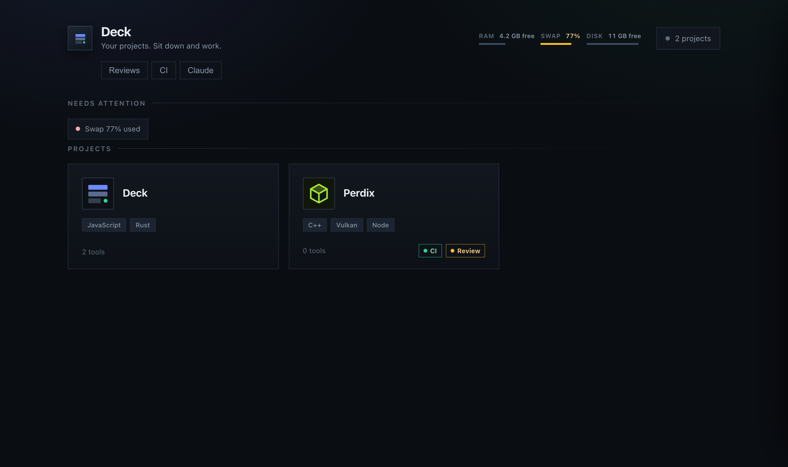
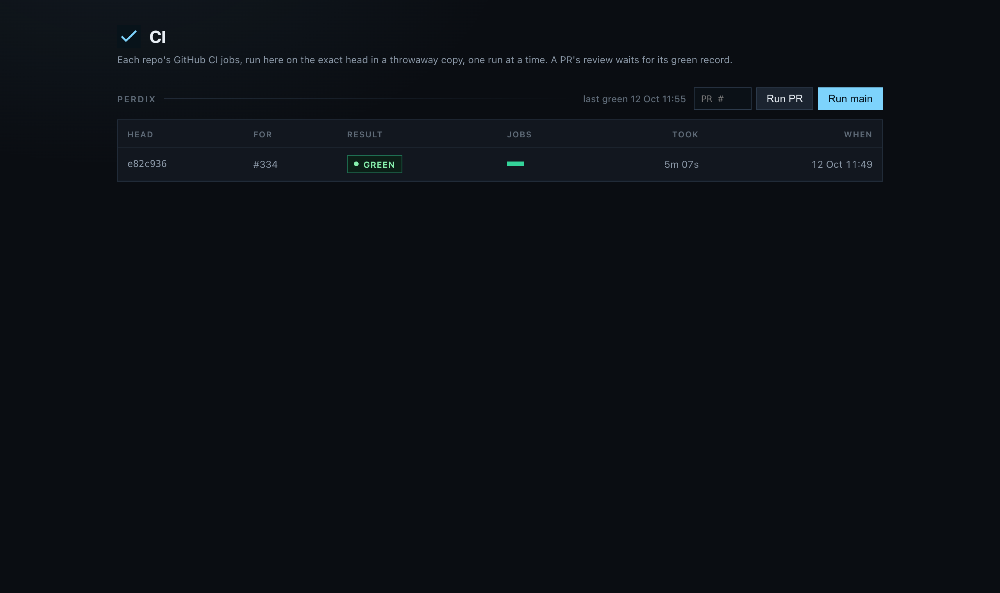
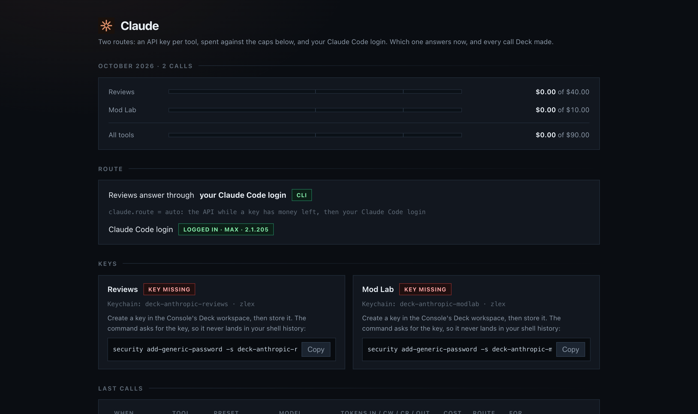
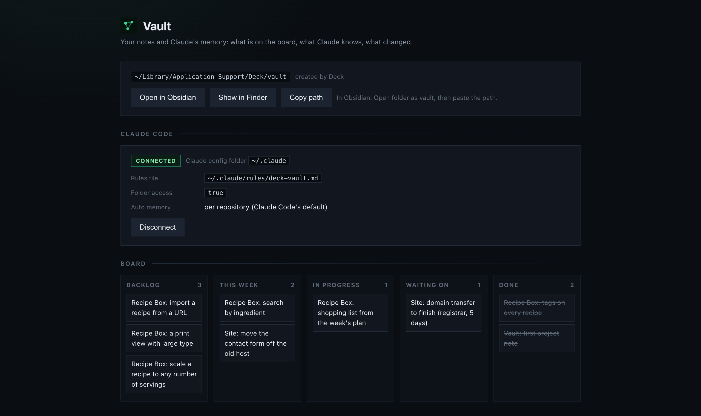

# Deck

A local control panel for your dev tools. One window to start, stop and tail
every tool you run, see each project's git state, run its CI on your own
machine, and let a pull request merge only after green CI and a Claude review.

I built it to run my own projects: a C++ voxel engine, a Java game engine and a
web platform, each with its own servers, tools and CI. Everything specific to
one setup lives in Deck's config folder, so the same code runs anyone's.

macOS. A small Node gateway (no framework) serves the pages; an optional
native window wraps it (Tauri).



## Run it

```bash
git clone https://github.com/zlexo/deck && cd deck
npm install
npm start            # http://localhost:8800
```

The first run copies the examples into Deck's config folder (a web server, a
ticker, and Deck itself as a project), so there is something to start right
away. `deck config` shows where that folder is.

## What it does

### Tools and projects

Every tool is a manifest: a JSON file in the config folder's `tools/`, or a
`deck.json` inside any project folder (the direct children of your home folder
are scanned; `scanRoots` in `state.json` changes that).

```json
{
  "id": "hello",
  "name": "Hello server",
  "group": "Examples",
  "cwd": "~/code/hello",
  "cmd": ["node", "server.js"],
  "url": "http://localhost:{port}",
  "portKey": "port",
  "config": { "port": { "type": "number", "flag": "--port", "default": 8899 } },
  "paths": { "Output": "~/code/hello/out" }
}
```

- `config` fields (`number`, `string`, `path`, `enum`, `bool`) become a CLI
  `flag` or an `env` variable; values saved in the page are passed on the next
  start. `{key}` placeholders in `url` are filled from them.
- `paths` become buttons that open the folder in Finder.
- A project card (`projects/*.json`) groups tools, repos, servers and a dev
  client, and shows each repo's branch, changes and ahead/behind.
- **`prelaunch`**: steps that must succeed before a server or dev client
  starts. A project that pulls a library from a local repository republishes it
  first, so editing the library and pressing Run never launches the old one.

### CI on your machine

`deck ci <repo> <pr|sha|main>` runs a repo's jobs, the same checks as its
GitHub workflow, in a throwaway worktree, never in your checkout. Every run is
recorded per commit, and project cards show the result.

- Runs take a machine lock, so two heavy builds never overlap.
- A run does not start under 3 GB of free disk, and a running job is stopped
  under 1 GB.
- Jobs can be limited to pull requests, to heads that change a path, or skipped
  by a label; a job's log drops lines that only show progress.



### Reviews and the merge gate

When a pull request's CI is green, Reviews asks Claude for a review: the diff
with context, the repo's own rules files, the design documents the PR names,
and lessons from earlier reviews. Every finding must quote the real lines it is
about, and a blocker gets a second, independent look before it can block a
merge. The verdict is posted as a `review-gate` commit status.

`deck review --check <repo> <pr>` is the merge gate:

| Exit | Meaning |
|---|---|
| 0 | mergeable: green CI and a review with no open blocker, or an override |
| 2 | blocked: an open blocker and no override |
| 3 | not reviewed because of money or availability (budget, credits, the plan's limit, a missing key, rate limits, overload): allowed on CI alone, and the PR says so |
| 4 | the head or the base changed since the review |
| 5 | no green CI for this head |
| 6 | no review for this PR |
| 7 | the review failed for another reason: review again, or override with a reason |
| 1 | usage or internal error |

`deck merge <repo> <pr>` merges through the gate: pull requests stacked on this
one are retargeted to its base first (deleting a merged base branch would close
them), and the merge is pinned to the exact head the gate checked.

A finding from a real review of a Perdix pull request (fog for chunks and bodies,
about 600 lines), answered through a Claude Code login:

> **Question: app/src/main.cpp:501**
>
> ```
> vx::app::frame_fog(overlay.fog(), overlay.held_view_distance().value_or(distance.chunks));
> ```
>
> **Problem.** The wiring in `draw_frame` is not covered by any test shown: reading
> `overlay.fog()`, using the held distance, and passing `.fog = fog` to the renderer.
> `frame_fog` and the overlay accessors are unit tested, but `main.cpp` is not.
>
> **How it breaks.** Someone drops `.fog = fog` from the `render` call, or passes
> `distance.chunks` instead of the held distance. Every shown test stays green, and
> the app draws without fog, or with the wrong fog, when the memory budget lowers the view.

### The Claude kit

The one place Deck calls Claude, with two routes:

- **An API key per tool**, kept in the macOS Keychain, with monthly caps per
  tool and in total. Every call is checked against the caps first and written
  to a ledger after: tokens, cache use and cost.
- **Your Claude Code login**, through one isolated `claude -p` call: no tools,
  so the code under review cannot make it run anything; no MCP servers, no
  saved session, an empty temporary folder, and no `ANTHROPIC_*` variables.

`claude.route` in `state.json` picks: `auto` (the API while a key has money
left, then your login), `api` or `cli`. The Claude page shows which route
answers right now and every call either route made.



### Apps from GitHub

Tools can live in their own repos. Tag a repo `deck-app` and give it a
`deck.json` at its root, and it shows up on the Apps page of every Deck that
watches its owner (`apps.sources` in `state.json`; private repos work through
your `gh` login). Install shows the exact commands first, then clones into
Deck's apps folder and runs the manifest's `install` steps; a badge appears when
the author publishes a new release, and Update brings it in. An app's own data
goes to a folder outside it, so updating or removing an app never touches what
it saved.

An app can take **content packs**: repos tagged with the app's pack topic, each
with a `pack.json`, installed and updated the same way, into a folder the app is
given (`DECK_APP_PACKS`). Publishing a new version of a pack is how its author
reaches everyone who installed it.

### Machine guard

RAM, swap and disk meters in the header, a sweep for orphaned dev processes,
and a cleanup drawer of folders that can be rebuilt (build output, package
caches, render leftovers), each with its size and what rebuilds it. Every path
is checked against its rule again right before it is deleted.

### The vault: a memory for Claude Code (optional)

Claude Code starts every session blank. The vault is a private folder of plain
markdown notes on your Mac that every Claude Code session reads before it acts
and writes into as it works: the board of what is in flight, a note per
project with its decisions, a line per day. Deck keeps it in git and pushes it
only to a private GitHub repo.



**Create or adopt.** Create on the Vault page copies a starter vault into
Deck's data folder, `~/Library/Application Support/Deck/vault` (not synced to
iCloud, backed up by Time Machine), and makes its first commit:
`CLAUDE.md` (the manual Claude follows), `Home.md` (the index),
`Boards/Work.md` (Backlog, This Week, In Progress, Waiting On, Done), and
`Daily/`, `Projects/`, `Knowledge/` and `Templates/`. It writes only into a new
or empty folder. Or point Deck at a folder you already have: it is used as it
is, and Deck writes nothing into it. Deck never deletes a vault.

**Connect.** Connect changes exactly two files in Claude Code's config folder
(`$CLAUDE_CONFIG_DIR`, else `claude.configDir` in `state.json`, else
`~/.claude`), and shows them as a diff before it writes anything:

- `rules/deck-vault.md`, a file Deck owns, which Claude Code loads in every
  project. It imports the vault's `CLAUDE.md`, so the manual is in every
  session, started from any folder.
- `settings.json`: the vault is added to `permissions.additionalDirectories`,
  so sessions read and edit it like their own folder. With the auto memory box
  ticked, `autoMemoryDirectory` points at the vault's `Memory/`, one memory for
  every project instead of one per repository; the box says how many
  per-repository memory files stop loading (they stay where they are).

`settings.json` is parsed first (if it does not parse, Deck changes nothing and
shows the lines to add by hand), copied to `settings.json.deck-<timestamp>`
beside itself, and written atomically. Connect refuses a rules file it did not
write, and an `autoMemoryDirectory` that already points somewhere else.
**Disconnect** takes out the rules file and the keys Connect added; when
nothing else changed since, `settings.json` is the backup's bytes again. The
vault stays. Disconnect before removing Deck.

**Deck's own calls stay out.** The Claude kit's calls through your login run
with `--safe-mode` (no `CLAUDE.md`, rules files, hooks, plugins, skills or MCP)
and with auto memory switched off, so a review never carries your vault or
your memory. The one vault note a review reads is
`Knowledge/Review Lessons/<repo>.md`, when it exists.

**Git.** `vault.git` picks the mode:

- `auto`, the default for a vault Deck created: commit after 10 quiet minutes
  (nothing in the vault changed) and at quit, then push. One commit per quiet
  spell, `Vault: N notes`, with the files in its body.
- `push`: Deck never commits the vault; it pushes `main` once it has been still
  for 10 minutes, for a vault something else commits to.
- `off`: status only. An adopted vault starts here.

Every commit is scanned for secrets first (Anthropic, OpenAI and GitHub tokens,
AWS key ids, private-key blocks). A file with a hit is held back and the page
shows where, never what. Before every push the commits origin does not have are
scanned again, merge resolutions included, and Deck asks GitHub whether the
repo is private: public, internal or no answer means no push, and the page
says why. The remote is a GitHub repo you name, or one Create private repo
makes (`gh repo create <name> --private`, the command shown first). Only
`main` is pushed, and only the exact commit that was scanned.

When origin has commits this Mac does not, `auto` merges them only on a clean
tree, after testing the merge in memory (`git merge-tree`); a conflict touches
nothing, stops pushing and lists the files. Never a rebase. `push` never
merges, and quit never fetches or merges: what is left waits for the next
start.

**The memory mirror.** `vault.memoryMirror` names a folder (one of Claude
Code's auto memory folders, say) that Deck copies into `Memory/` and commits on
its own, in `auto` and `push`. It never overwrites or deletes a `Memory/` file
it did not write, never copies a file with a secret in it, and stays off while
Claude Code writes its auto memory into the vault itself.

**The page.** The Vault page shows the setup panel until there is a vault,
then the path (Open in Obsidian, Show in Finder, Copy path), Claude Code's
connection with Connect and Disconnect, the board as read-only columns, and
git: the mode, changes waiting, the last commit and its files, the remote with
its private check, ahead and behind, the last push, Commit now and Push now.
Below them: quick capture into today's daily note, the daily itself, recent
notes, tasks and this week's focus time.

**Apps that use the vault.** An app whose `deck.json` says `"vault": true`
gets the vault's path as `DECK_VAULT` when Deck starts it; no other tool does.
The page lists these apps with Open and, when the manifest names a `status`
route on this Mac, its one-line status.

**Focus.** With a vault, **Focus** reads a plan table from a note
(`focus.goals`) to put the current main project first on the home grid. Without
a vault or a plan, the grid shows everything.

## Configuration

Deck keeps its own config outside the checkout, in
`~/Library/Application Support/Deck/config/` (`DECK_CONFIG` moves it):
`tools/`, `projects/`, `folders.json` and `state.json`.

| `state.json` key | What it sets |
|---|---|
| `scanRoots` | folders whose direct children are searched for `deck.json` |
| `repos` | the repos that get CI and reviews: name, GitHub slug, path, project card |
| `ci.repos` | each repo's jobs |
| `reviews.repos` | each repo's rules files, design source and risk globs |
| `claude.route`, `claude.caps` | the route, and the monthly caps in USD |
| `merge.authorEmail` | the merge commit's author email (else git's `user.email`) |
| `focus`, `guard` | the Focus plan; the guard's meter thresholds and an extra cleanup target |
| `apps.sources` | the GitHub owners whose `deck-app` repos the Apps page lists |
| `vault.path` | the vault folder; Create and Adopt set it |
| `vault.created` | set by Create; a created vault's git mode defaults to `auto` |
| `vault.git` | `auto`, `push` or `off` |
| `vault.remote` | the vault's GitHub repo, `owner/name` |
| `vault.memoryMirror` | a folder copied into the vault's `Memory/` |
| `claude.configDir` | Claude Code's config folder for Connect (Deck.app sees no shell variables) |

`DECK_VAULT` wins over `vault.path` (Create and Adopt refuse while it is set);
without either, Deck uses `~/vault` when it exists. A vault from `DECK_VAULT`
or `~/vault` has git `off`.

[`examples/state.example.json`](examples/state.example.json) is a worked setup
for a C++ engine and a web app.

## The `deck` command

```text
deck review <repo> <pr>                  run a review now
deck review --check <repo> <pr>          the merge gate
deck review --override <repo> <pr> --reason <text>
deck merge <repo> <pr> [--dry-run]       merge through the gate
deck ci <repo> <pr|sha|main>             run CI in a throwaway worktree
deck claude                              the route, keys, spend, last calls
deck config                              where the config is read from
deck config migrate [--dry-run]          move a checkout's config into the config folder
deck vault status                        the vault's connection to Claude Code
deck vault connect [--dry-run] [--no-auto-memory]
                                         show the changes, then make them
deck vault disconnect                    take out what Connect added
```

`npm run cli:install` puts `deck` on your PATH.

## The native app

`npm run app:install` builds Deck.app (Tauri; needs Rust and Bun) and installs
it. The app runs the same gateway, compiled, and opens each tool in its own
tab. If the compiled gateway is older than the checkout's code, the home page
says so instead of failing quietly.

Quitting the app (⌘Q, the Dock, closing its window) stops every tool it
started, each within its own `stopGraceMs`, then the gateway, and then anything
a tool left behind. The window goes at once; the app quits once the last tool
has stopped. A gateway that an earlier run left running (the app crashed or
was killed) is stopped the same way when the app starts again.

## Requirements

macOS, Node 22.12 or newer, git. `gh` for reviews and merges. For reviews,
either an Anthropic API key or Claude Code logged in.

## Development

- `npm test`: the unit and gateway tests (327). They run with `DECK_CLI=off`,
  so no test can reach a real `claude` CLI.
- `npm run check`: syntax of every file, the tests, and a smoke test of the
  compiled gateway with launchd's bare PATH.
- `npm run check:quit`: builds a test copy of the app (its own name and
  identifier, so it runs beside an installed Deck), quits it with stand-in
  tools running and checks that its window goes at once and nothing is left:
  no `deck-server`, the port free, no orphaned tool. `-- --stale` and
  `-- --hung` add a crashed app and a frozen gateway (the cases are in the
  header of `scripts/check-quit.mjs`).
- `npm run check:vault`: the live check against the real Claude Code. In a
  throwaway Deck and a throwaway Claude config it creates a vault, connects,
  and checks that a session in an empty folder quotes a line planted in the
  manual (and one planted in `Memory/`), that a kit call quotes neither, and
  that after Disconnect no session does and `settings.json` is as it was. It
  needs a login made once in the throwaway config:

  ```bash
  CLAUDE_CONFIG_DIR="$HOME/.cache/deck-check/claude" claude auth login
  ```
- [`docs/v2/`](docs/v2/) holds the design contract, CI and Reviews as they
  were planned before they were built.

## License

Source-available, all rights reserved: you may read the code; using, copying or
changing it needs written permission. See [LICENSE](LICENSE).
